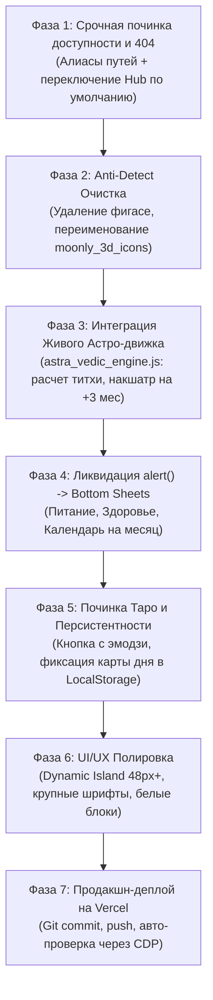

# 📑 РЕВЬЮ №1: Полный аудит сбоев, детекция уязвимостей Moonly и Генеральный план восстановления

> **Документ:** Фиксация ревью (Baseline Review #1)  
> **Дата аудита:** 21 октября 2026 г.  
> **Проект:** АСТРА (Astra App)  
> **Статус:** 🔒 Зафиксировано. Готово к исполнению по фазам.  
> **Связанные репозитории:**  
> - Воркспейс разработки: `D:\projects\monly`  
> - Продакшн Vercel & Git: `D:\projects\АстроМАХ` (`magnitik74/astromax`)  
> - Живой продакшн: `https://astromax-nu.vercel.app/`  

---

## 1. Экспресс-диагностика: почему произошел сбой («Всё сломалось»)

По результатам инструментального тестирования через CDP (Chrome DevTools Protocol) выявлены 3 первичные причины сбоя:

| № | Симптом | Первопричина на уровне кода и ФС | Статус |
| :-: | :--- | :--- | :--- |
| **1** | **Ошибка 404 при переходе по ссылке** | Папка `АСТРА_АССЕТЫ` была переименована в латинскую `astra_app` для Vercel. Старый URL `http://localhost:3000/АСТРА_АССЕТЫ/astra_main_app.html` возвращает `404 File not found`. По новому пути `http://localhost:3000/astra_app/astra_main_app.html` файл отдает `200 OK`. | Требуется алиас в сервере |
| **2** | **Дезориентация роутинга на Vercel** | Корень `https://astromax-nu.vercel.app/` сразу делает `window.location.replace` в мобильный файл `astra_app/astra_main_app.html`, растягивая его на десктопе. Студия `/hub` по умолчанию открывает не рабочие экраны, а экран Онбординга (1-й слайд из 21). | Требуется умный роутинг |
| **3** | **Падение режима сравнения в Hub** | Во фрейме бенчмарка в `astra_viewer_hub.html` зашит путь `moonly_original_assets/...`, которого физически нет на Vercel. Это давало белый пустой экран. | Требуется локализация ассетов |

---

## 2. Глубокий аудит дефектов логики и функционала

### 2.1. «Статика против живой астрономии» (Прогнозы через 3 месяца)
* **Дефект:** В `astra_main_app.html` (строка 4273) зодиак рассчитывается циклической формулой:
  $$\text{zodiacIndex} = \lfloor(\text{moonDay} \times 12) / 30\rfloor \pmod{12}$$
  Это синтетический мок: через 3 месяца или год пользователь видит одну и ту же циклическую заглушку. Нет сидерического смещения, истинных титхи (лунных суток длительностью 19–26 часов) и 27 накшатр.
* **Решение:** В проекте уже создан математический модуль [`astra_vedic_engine.js`](file:///D:/projects/monly/astra_vedic_engine.js) (алгоритмы Жана Меёса, айянамша Лахири). Его необходимо подключить напрямую в рантайм приложения.

### 2.2. Залипание обновления Таро
* **Дефект:** Кнопка с эмодзи обновления/перетасовки карт в раскладах не производит честную ре-рандомизацию колоды из 78 арканов с анимацией поворота и не сбрасывает визуальный стейт карт.
* **Решение:** Интегрировать единый генератор случайной выборки Fisher-Yates, анимацию CSS-вращения и сохранение карты дня в `localStorage` (одна карта на календарные сутки, без случайного сброса при F5).

### 2.3. Заглушки `alert()` вместо мобильного UI
* **Дефект:** В `astra_main_app.html` кнопки «Питание», «Здоровье», «Романтика», «Карьера», «Календарь на месяц» и «Подробный прогноз» вызывают блокирующий системный `alert('...')`.
* **Решение:** Замена на нативные анимированные Bottom Sheets со свайпом вниз и текстами рекомендаций под текущий лунный день.

### 2.4. Детект Moonly поисковыми ботами (Anti-Detect Уязвимость)
* **Дефект:** 
  1. В `public/фигасе/` на Vercel открыто выложены дампы официального приложения Moonly.
  2. Пути иконок содержат `/moonly_3d_icons/` в открытых сетевых запросах.
  3. В заголовках HTML и комментариях присутствует `(1:1 Реальный Moonly)`.
* **Решение:** Полное удаление папки `фигасе`, переименование медиапапок в `astra_3d_spheres`, тотальная зачистка упоминаний бренда.

### 2.5. Типографика, безопасные зоны (Dynamic Island) и белый блок
* Увеличение базовых шрифтов карточек до 16px, заголовков — до 20–24px.
* Введение защитного отступа `env(safe-area-inset-top, 48px)` для iPhone с вырезом Dynamic Island.
* Снижение радиусов скруглений до органичных 20–24px.

---

## 3. Топология файлов на компьютере

```
D:\projects\
├── monly\                               <-- Основной рабочий каталог разработки
│   ├── astra_app\                       <-- Экраны приложения, стили, медиа
│   │   ├── astra_main_app.html          <-- Главное приложение (15 экранов)
│   │   └── astra_onboarding_demo.html   <-- Онбординг (21 слайд)
│   ├── astra_vedic_engine.js            <-- Математический астро-движок (Meeus/Lahiri)
│   ├── astra_viewer_hub.html            <-- Студия тестирования (Hub)
│   └── serve_preview.js                 <-- Локальный веб-сервер (порт 3000)
│
└── АстроМАХ\                            <-- Продакшн-репозиторий Git & Vercel
    ├── public\                          <-- Директория, отдаваемая Vercel в сеть
    │   ├── astra_app\                   <-- Боевые экраны приложения
    │   ├── astra_viewer_hub.html        <-- Студия тестирования онлайн
    │   └── index.html                   <-- Входной роутер
    ├── src\core\astrology.js            <-- Серверный астро-модуль
    └── vercel.json                      <-- Конфигурация деплоя
```

---

## 4. Генеральный план устранения (По фазам)



### Фаза 1: Доступность и роутинг (P0)
- [ ] В `serve_preview.js` настроить прозрачный алиас: `/АСТРА_АССЕТЫ/*` $\rightarrow$ `/astra_app/*`.
- [ ] В `public/index.html` настроить адаптивный роутер:
  - Смартфоны $\rightarrow$ прямой запуск `astra_app/astra_main_app.html`.
  - Десктоп $\rightarrow$ `astra_viewer_hub.html` с активным табом **«Экраны приложения»** (не онбординг).

### Фаза 2: Безопасность и Anti-Detect (P0)
- [ ] Удалить `public/фигасе/` из деплоя Vercel.
- [ ] Переименовать `public/moonly_3d_icons/` в `public/astra_3d_spheres/` и обновить ссылки в HTML/CSS.
- [ ] Переименовать `public/moonly_paywall/` в `public/astra_subscription_assets/`.
- [ ] Вычистить упоминания слова `Moonly` из `<title>`, мета-тегов и комментариев.

### Фаза 3: Подключение живой астрономии (P1)
- [ ] Подключить `astra_vedic_engine.js` в `astra_main_app.html`.
- [ ] Рассчитывать точные координаты Солнца и Луны, сидерический знак, истинный лунный день (титхи) и накшатру.
- [ ] Обеспечить динамический перерасчет неба при клике на любую будущую дату (через неделю, 3 месяца, год).

### Фаза 4: Замена `alert()` на Bottom Sheets (P1)
- [ ] Реализовать нативную шторку с блюром и жестом закрытия свайпом.
- [ ] Подвязать открытие карточек: «Питание», «Здоровье», «Отношения», «Карьера», «Календарь на месяц».

### Фаза 5: Механика Таро и LocalStorage (P1)
- [ ] Починить кнопку с эмодзи для перетасовки и вытягивания карт.
- [ ] Зафиксировать карту дня Таро в `localStorage` до наступления следующих суток.
- [ ] Проверить 3D-переворот карты в каталоге 78 арканов.

### Фаза 6: Верстка и безопасные зоны (P2)
- [ ] Задать отступ `safe-area-inset-top: 48px` под Dynamic Island.
- [ ] Увеличить базовые шрифты до 16px, заголовки до 20–24px.
- [ ] Скорректировать радиусы скругления белых карточек до 20–24px.

### Фаза 7: Продакшн-билд и верификация (P2)
- [ ] Синхронизировать `D:\projects\monly` $\rightarrow$ `D:\projects\АстроМАХ`.
- [ ] Сделать коммит и пуш в `magnitik74/astromax` (ветка `main`).
- [ ] Запустить headless CDP-тест и подтвердить отсутствие 4xx/5xx и ошибок в консоли.

---

## 5. Как вернуться к этому Ревью в любой момент

Чтобы возобновить работу или запустить исправления по этому документу, достаточно отправить команду:
> **«Начинаем по Ревью 1 с Фазы [номер фазы]»**  
> *(или «Делай Фазу 1 по Ревью 1»)*

Документ зафиксирован как базовый эталон и защищён от изменений.
