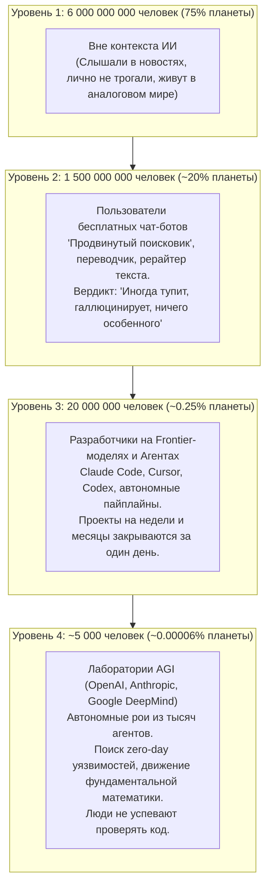
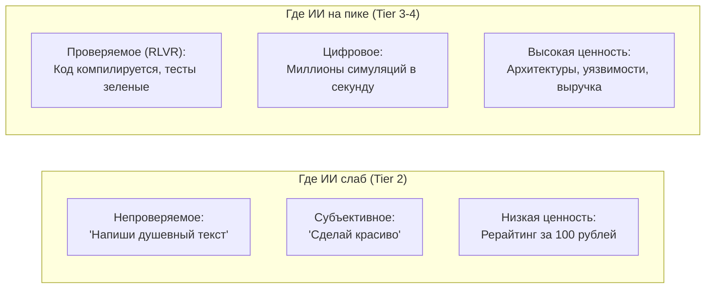

# 🆕 Карпатый: 5000 человек живут в другом ИИ-мире, чем остальные 8 млрд
### Полный построчный разбор манифеста Андрея Карпатого: скрытая механика сингулярности, экономика верифицируемых наград и методология прыжка в верхний 0.00006%

---

> *«Разрыв в понимании возможностей LLM за полгода только вырос и стал похож на резкую воронку. Большинство людей видит глуповатого бота, а небольшая прослойка уже чувствует головокружение от кривой, которая уходит вертикально вверх. И всё это одновременно».*  
> — **Андрей Карпатый (OpenAI, экс-директор AI в Tesla)**

---

## 1. Анатомия 4 миров: Как на самом деле устроена воронка человечества

Андрей Карпатый ввел не просто статистику — он описал **расслоение цивилизации на 4 параллельные реальности**, существующие на одной планете в одну секунду времени:

---

## 2. Разбор цитат: Механика трех законов воронки

### 📜 ЦИТАТА 1: Масштаб задачи
> *«Отдача растёт с размером задачи, и вопрос на абзац систему почти не нагружает».*

#### Что Карпатый имеет в виду:
* Большинство людей формулируют запрос так: *«Напиши пост для блога»*, *«Переведи письмо»*, *«Объясни, что такое квантовая физика»*.
* Для LLM это нагрузка на 0.0001% ее архитектурной мощности. Ответ получается поверхностным, общим, «водянистым». Человек разочаровывается: *«Ну вот, машина пишет как посредственный копирайтер»*.
* **В чем закон:** Современные frontier-модели раскрывают экспоненциальный интеллект только тогда, когда им скармливают **системную проблему**:
  * Не «напиши функцию», а «вот кодовая база на 50 000 строк, проведи рефакторинг архитектуры, найди утечки памяти, перепиши на асинхронный пайплайн и покрой 200 интеграционными тестами».
  * Не «придумай слоган», а «вот финансовый отчет за 3 года, маркетинговая воронка конкурента и логи веб-сервера — найди, где мы теряем 30% маржи, и спроектируй новую продуктовую матрицу».
* **Правило Карпатого:** *Leverage модели пропорционален когнитивному объему постановки задачи*. Мелкая задача делает ИИ глупым; колоссальная задача заставляет его мобилизовать скрытые слои рассуждений.

---

### 📜 ЦИТАТА 2: Цифровое, проверяемое и денежное (Секрет RLVR)
> *«Способности модели неровные: пик там, где задачи цифровые, проверяемые и денежные, потому что RL на верифицируемых наградах настраивают под выручку».*

#### Что Карпатый имеет в виду:
Это самый глубокий технический и экономический инсайт всего манифеста. Он объясняет, **почему ИИ в одних вещах — бог, а в других — первоклассник**.

1. **Почему «цифровое»?**  
   Потому что в цифровой среде нет трения физического мира. Агент может сделать 10 000 попыток за минуту.
2. **Что такое «проверяемое» (Verifiable)?**  
   В машинном обучении произошел тектонический сдвиг: от обучения с учителем (человек оценивает «красиво/некрасиво») индустрия перешла к **RLVR (Reinforcement Learning on Verifiable Rewards)**:
   * *Код:* Запустили тесты. Код скомпилировался? Тесты прошли? Да (награда +1) / Нет (награда 0).
   * *Математика:* Теорема доказана? Формула сходится? Да/Нет.
   * *Кибербезопасность:* Эксплойт пробил защиту? Да/Нет.
   * *Трейдинг:* Бэктест принес PnL? Да/Нет.
   Там, где есть **бинарный объективный критерий проверки**, модель можно прогнать через миллионы циклов самообучения без участия человека.
3. **Почему «денежное»?**  
   Инвесторы и лаборатории тратят миллиарды долларов на вычислительные кластеры только туда, где есть немедленная монетизация: генерация работающего софта, безопасность банков, алгоритмический арбитраж. ИИ тренируют там, где крутятся капиталы.

---

### 📜 ЦИТАТА 3: Иерархия доступа
> *«И доступ: бесплатный, платный или внутренний».*

#### Что Карпатый имеет в виду:
* **Бесплатный доступ (Free tier):** Урезанные модели, квантованные веса, маленькие контекстные окна, жесткие лимиты размышлений (Thinking tokens). Это витрина, демо-версия для 1.5 млрд людей.
* **Платный доступ (Pro / API / CLI):** Полноразмерные frontier-модели с глубоким reasoning (цепочками рассуждений), доступом к терминалу, инструментам (MCP, bash, браузер), файловой системе и контекстом на 200 000 – 2 000 000 токенов.
* **Внутренний доступ (Internal lab clusters):** Доступ, который имеют ~5 000 инженеров. Это не чат в браузере. Это тысячи параллельных инстансов невыпущенных моделей следующего поколения, объединенных в саморефлексирующие графы.

---

### 📜 ЦИТАТА 4: Рои агентов и отставание человека
> *«А примерно 5000 человек внутри лабораторий наблюдают рои из тысяч агентов, которые неделями ищут zero-day, двигают науку и математику быстрее, чем люди успевают это проверять».*

#### Что Карпатый имеет в виду:
* **Отказ от парадигмы «Один человек — один чат»:**  
  Внутри передовых лабораторий человек больше не пишет промпты вручную. Человек выступает **директором виртуального исследовательского института**.
* **Как устроен рой (Swarm):**
  * Агент-Архитектор декомпозирует сверхзадачу на 50 подзадач.
  * 50 агентов-исследователей собирают гипотезы параллельно.
  * 100 агентов-кодеров пишут реализации.
  * 50 агентов-критиков (Red Team) целенаправленно ломают написанное, ищут логические дыры и баги.
  * Агент-Судья отбирает только верифицированные решения.
* **Проблема «Human lag» (Отставание человека):**  
  Количество генерируемого математического и программного знания превышает пропускную способность человеческого мозга. Человек физически не способен вычитать 100 000 строк за день. Мы подходим к моменту, когда верификацией ИИ могут заниматься только другие ИИ.

---

### 📜 ЦИТАТА 5: Головокружение от вертикали
> *«Большинство людей видит глуповатого бота, а небольшая прослойка уже чувствует головокружение от кривой, которая уходит вертикально вверх. И всё это одновременно».*

#### Что Карпатый имеет в виду:
* Человеческий мозг эволюционно привык к линейным процессам (если сегодня урожай вырос на 5%, то и завтра на 5%).
* Экспонента обманчива: она долго ползет около нуля, а затем делает резкий угол в 90 градусов.
* Для обывателя ничего не изменилось: бот в телефоне всё так же иногда путает рецепты борща.
* Но те, кто видит, как ИИ-агенты за ночь переписывают операционные системы и доказывают открытые гипотезы, понимают: **кривая уже перешла в вертикальную фазу**.

---

## 3. Мета-методология Карпатого: Как применить это к ЛЮБОМУ проекту в жизни и бизнесе

Если убрать рамки конкретного софта или ниши, манифест Карпатого формулирует **универсальный алгоритм сверх-результативности в XXI веке**.

### ПРАВИЛО 1: Убей промптинг «на абзац» — переходи к формулированию макро-систем
* **Старый подход:** Задать короткий вопрос → получить средний ответ → разочароваться.
* **Подход Карпатого:** Дать модели задачу максимального масштаба:
  * Вход: вся документация, контекст, ограничения, исторические ошибки, целевые метрики.
  * Требование: спроектировать систему от нуля до конца с альтернативными сценариями.

### ПРАВИЛО 2: Создавай «Верифицируемые награды» (Verifiability Loop)
Если ты хочешь, чтобы ИИ решал задачу гениально, ты должен дать ему **машину проверки**:
1. Не проси: *«Напиши стратегию продаж»*.
2. Скажи: *«Вот финансовая модель в Excel. Напиши стратегию и прогони ее через симуляцию конверсий при худшем, среднем и лучшем сценарии. Стратегия принимается только если LTV/CAC > 3 и срок окупаемости < 90 дней. Если критерий не выполнен — переделывай стратегию заново»*.
3. Как только у модели появляется измеримый критерий отсева ошибок — она начинает выдавать результат уровня Tier 3/4.

### ПРАВИЛО 3: Перестань работать в одиночку — строй рои агентов
В любой задаче (будь то маркетинг, разработка, инвестиции или наука) разбивай ИИ на роли с конфликтом интересов:
* **Агент-генератор (Креатор):** придумывает решения.
* **Агент-критик (Devil's Advocate):** ищет почему это провалится, бьет по слабым местам.
* **Агент-валидатор (Фактчекер):** проверяет каждую цифру и источник.
* **Агент-арбитр (Синтезатор):** собирает итоговый результат, выдержавший критику.

### ПРАВИЛО 4: Переход из Tier 2 в Tier 3
* 99% твоих конкурентов в любом бизнесе используют бесплатный чат-бот для написания постов или ответов на почту (Tier 2). Они видят «глуповатого бота».
* Если ты строишь сквозные мультиагентные пайплайны, подключаешь верификацию, работаешь с кодовой базой и глубоким контекстом — ты автоматически перемещаешься в Tier 3 (верхние 0.25%).
* Твоя скорость реализации и глубина проработки становится недосягаемой для тех, кто остался внизу воронки.

---

> ### Финальный вывод Карпатого:
> **Мир разделился не на тех, у кого есть ИИ, и тех, у кого его нет.**  
> **Мир разделился на тех, кто общается с ботом в чате, и тех, кто дирижирует автономными когнитивными фабриками.**
